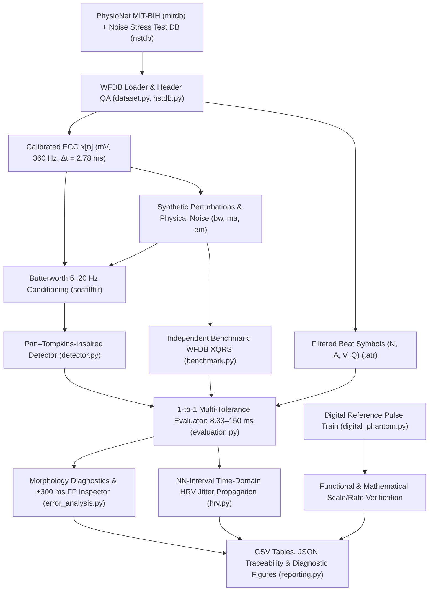

# ECG-Integrity-Lab (`v0.2.0`)

**Open ECG Signal Conditioning, Temporal Accuracy & Noise Sensitivity Verification Framework**  
*Beyond F1-Score: Evaluating beat detection, temporal localization jitter, physical NSTDB noise, morphology sensitivity, and HRV propagation*

A computer-only biomedical engineering framework designed to characterize physiological signal conditioning, ADC header verification, functional software reference testing, multi-tolerance QRS evaluation, physical noise stress testing (`mitdb` + `nstdb`), morphology-specific failure analysis, and reproducible QA/QC.

---

## System Architecture



### Core Modules (`src/ecg_integrity/`)

| Module | Responsibility |
| :--- | :--- |
| `dataset.py` | Load MIT-BIH records & `.atr` annotations; verify $f_s = 360\text{ Hz}$, units (`mV`), ADC gain/baseline, finiteness, and exclude non-beat markers (`+`, `~`, `\|`). |
| `signal_processing.py` | Zero-phase 4th-order Butterworth SOS bandpass ($5\text{–}20\text{ Hz}$) and reproducible synthetic perturbations ($0.25\text{ Hz}$ wander, $60\text{ Hz}$ mains, seeded AWGN). |
| `nstdb.py` | Load physical ambulatory noise (`bw`, `ma`, `em`) from PhysioNet's **MIT-BIH Noise Stress Test Database** and mix at controlled SNRs ($24$ to $-6\text{ dB}$). |
| `detector.py` | Pan–Tompkins-inspired QRS detector with dynamic threshold trace (`THRESHOLD_I1`) and optional sub-sample parabolic refinement (`refine_peaks_parabolic`). |
| `evaluation.py` | Strict 1-to-1 beat matching, multi-window **tolerance sweep** ($8.33, 16.67, 25, 50, 100, 150\text{ ms}$), and pooled micro-aggregated count metrics. |
| `error_analysis.py` | Beat-symbol stratification (`N, A, V, Q`), biophysical feature extraction ($A_{\text{QRS}}, W_{\text{QRS}}, \max\|dV/dt\|, E_{\text{QRS}}$), and $\pm 300\text{ ms}$ FP waveform inspector. |
| `benchmark.py` | Side-by-side comparison of Custom Pan–Tompkins against `wfdb.processing.xqrs_detect` under identical inputs and tolerances. |
| `hrv.py` | Quantifies how QRS localization jitter ($RR_i' = RR_i + e_{i+1} - e_i$) biases `RMSSD` and `SDNN` across verified normal-to-normal (`N`–`N`) sinus intervals. |
| `digital_phantom.py` | Deterministic $1.0\text{ mV}$ / $60\text{ bpm}$ digital pulse train for **functional and mathematical software verification** (distinct from physical hardware calibration). |
| `reporting.py` | Publication-grade visualization suite for waveforms, tolerance curves, NSTDB stress tests, FP galleries, PVC morphology boxplots, and XQRS benchmarks. |

---

## Scope, Safety & Methodological Rigor

- **Exploratory Engineering Framework (Not a Medical Device):** This software is a research and verification test bench, **not** a clinically validated diagnostic system or medical device. The $5\text{–}20\text{ Hz}$ passband is scoped solely to QRS detection and distorts P/T waves and ST-segment morphology.
- **Discrete Sampling Interval vs. Ensemble $\text{MAE}_t$:** At $f_s = 360\text{ Hz}$, individual discrete peak indices have a sampling interval of $\Delta t = 2.7778\text{ ms}$. Ensemble averages such as $\text{MAE}_t = 1.17\text{ ms}$ or $1.50\text{ ms}$ represent arithmetic means across beats, **not** sub-sample single-beat resolution. Signed error follows $e_i = t_{\text{det},i} - t_{\text{ref},i}$ (positive = detection lags behind reference).
- **Statistical Structure:** Evaluating `10,789` beats across `6` conditions yields `64,734` *paired repeated-measures evaluation opportunities*, not independent observations. Pooled baseline summaries aggregate raw `TP`, `FP`, and `FN` counts rather than averaging per-record percentages. Remember also that MIT-BIH's 48 records come from 47 unique subjects (`201` and `202` share one subject).

---

## Install & Run Tests (Windows PowerShell)

```powershell
py -3.12 -m venv .venv
.\.venv\Scripts\Activate.ps1
python -m pip install --upgrade pip
pip install -r requirements.txt
pip install -e .
pytest -v
```

### Functional & Mathematical Verification via Digital Reference Signals

```powershell
python examples/run_digital_phantom.py
```

Verifies `0.0%` nominal amplitude/rate error on a $1.0\text{ mV}$, $60\text{ bpm}$ digital pulse train and exact `+5.0%` error detection under a $1.05\times$ scale perturbation. *(Checks software math only; not traceable to SI and does not calibrate physical ECG hardware).*

---

## Reproducible Experimental Workflows (CLI)

### 1. Synthetic Perturbations + Tolerance Sweep + NN-HRV Jitter (`run`)

```powershell
# Initial 5-minute verification on Record 100
python -m ecg_integrity.cli run --record 100 --channel 0 --seconds 300

# 5-record 30-minute purposive stress-test pilot (10,789 reference beats)
python -m ecg_integrity.cli run --record 100 --channel 0 --seconds 1800 --output results/pilot
python -m ecg_integrity.cli run --record 101 --channel 0 --seconds 1800 --output results/pilot
python -m ecg_integrity.cli run --record 103 --channel 0 --seconds 1800 --output results/pilot
python -m ecg_integrity.cli run --record 105 --channel 0 --seconds 1800 --output results/pilot
python -m ecg_integrity.cli run --record 106 --channel 0 --seconds 1800 --output results/pilot
python examples/plot_pilot_summary.py --csv results/pilot/pilot_metrics.csv
```

Automatically generates `metrics.csv`, `tolerance_sweep.csv` ($8.33\text{–}150\text{ ms}$), `morphology_stratified.csv`, `hrv_jitter_metrics.csv`, `run_metadata.json`, and Figures 1–4 + `fig_tolerance_sweep.png`.

### 2. Real Physiological Acquisition Noise (`nstdb`: `bw`, `ma`, `em` across `24` to `-6 dB`)

```powershell
python -m ecg_integrity.cli nstdb --record 100 --channel 0 --seconds 1800
```

### 3. Morphology-Stratified & $\pm 300\text{ ms}$ False-Positive Diagnostics (`diagnose`)

```powershell
# Inspect all 33 False Positives (±300 ms multi-stage waveforms + THRESHOLD_I1) on Record 105
python -m ecg_integrity.cli diagnose --record 105 --channel 0 --seconds 1800

# Compare A_QRS, W_QRS, max|dV/dt|, and E_QRS/I1 across 512 TP vs 6 FN PVCs on Record 106 @ 5 dB
python -m ecg_integrity.cli diagnose --record 106 --channel 0 --seconds 1800 --snr-db 5
```

### 4. Independent Detector Benchmark vs. WFDB `XQRS` (`benchmark`)

```powershell
python -m ecg_integrity.cli benchmark --record 100 --channel 0 --seconds 1800
python -m ecg_integrity.cli benchmark --record 105 --channel 0 --seconds 1800
python -m ecg_integrity.cli benchmark --record 106 --channel 0 --seconds 1800
```

---

## Key Empirical Highlights (`v0.2.0`)

1. **Pooled Baseline Pilot (`10,789` beats across `100, 101, 103, 105, 106`):** `10,777 TP`, `37 FP`, `12 FN` (`Se = 99.89%`, `PPV = 99.66%`, `F1 = 99.77%`), with `33/37` FPs concentrated in motion-corrupted `Record 105`.
2. **Core Thesis — F1 Stability Masks Temporal Jitter & HRV Bias (`Record 100`):** Across Baseline $\rightarrow 5\text{ dB}$ AWGN, `F1` remains `100.00%`, yet ensemble $\text{MAE}_t$ rises $+30.7\%$ ($1.50 \rightarrow 1.96\text{ ms}$), $\sigma_t$ rises $+56.0\%$ ($1.68 \rightarrow 2.62\text{ ms}$), and normal-to-normal `RMSSD` ($n=2,196$ pairs) inflates by $+2.54\%$ ($27.80 \rightarrow 28.51\text{ ms}$).
3. **Matching-Window Sensitivity (`Record 106`):** Tightening tolerance from $\pm 150\text{ ms}$ to $\pm 8.33\text{ ms}$ ($\pm 3$ samples) reduces baseline F1 from `99.95%` to `95.79%` (`93.96%` at $5\text{ dB}$) due to R-peak fiducial dispersion across wide multiform PVCs.
4. **Physical `NSTDB` vs. Synthetic Noise:** While stationary $0.25\text{ Hz}$ / $60\text{ Hz}$ sinusoids and `nstdb/bw` produce `0 FP` down to $-6\text{ dB}$, physical muscle (`nstdb/ma`) and electrode motion (`nstdb/em`) at $-6\text{ dB}$ trigger `127 FP` (`PPV = 94.68%`) and `171 FP` (`PPV = 92.97%`), respectively.
5. **Biophysical Proof on `Record 106` Missed PVCs & `XQRS` Trade-off:** All `6` missed PVCs at $5\text{ dB}$ had $3.2\times$ lower slope ($18.6$ vs. $58.8\text{ mV/s}$) and $E_{\text{QRS}} / I_1 < 0.60$. Meanwhile, `WFDB XQRS` achieved tighter $\text{MAE}_t$ (`0.50 ms` on `100`) and fewer motion FPs on `105`, but missed `88` multiform PVCs on `106` (`Se = 95.65%` vs. `99.90%` for Custom Pan–Tompkins).

### Diagnostic Visuals


---

## Engineering & QA Documentation

- [`docs/EXPERIMENTAL_PROTOCOL.md`](docs/EXPERIMENTAL_PROTOCOL.md) — Complete Phase 1 & Phase 2 experimental design, tolerances, NSTDB SNR equations, and statistical structure.
- [`docs/LIMITATIONS_AND_QA_REPORT.md`](docs/LIMITATIONS_AND_QA_REPORT.md) — Detailed tables for micro-aggregated counts, tolerance sweeps, NSTDB stress tests, FP/FN diagnostics, XQRS benchmark, and HRV jitter.
- [`docs/TECHNICAL_PUBLICATION_DRAFT.md`](docs/TECHNICAL_PUBLICATION_DRAFT.md) — Manuscript draft: *"Beyond F1-Score: Evaluating Temporal Accuracy and Noise Sensitivity of a Pan–Tompkins-Inspired QRS Detection Pipeline"*.
- [`docs/REFERENCES.md`](docs/REFERENCES.md) — Citations for MIT-BIH (`mitdb`), Noise Stress Test (`nstdb`), Pan–Tompkins, WFDB/`XQRS`, and standards context (ANSI/AAMI EC57, IEC 60601-2-47).
