# ECG-Integrity-Lab (`v0.3.0`)

**Open ECG Signal Conditioning, Temporal Metrology & Evidence-Driven QRS Verification Framework**  
*From classical Pan–Tompkins conditioning (`v0.1.0`), through critical failure-mode & HRV jitter characterization (`v0.2.0`), to an enhanced sub-millisecond, artifact-gated, PVC-aware detector (`v0.3.0`)*

A computer-only biomedical engineering workbench built in Python to verify ECG header calibration, evaluate digital signal conditioning, stress-test QRS detectors under synthetic and physical ambulatory noise (`mitdb` + `nstdb`), diagnose biophysical failure mechanisms, propagate R-peak timing jitter into Heart Rate Variability (`RMSSD`), and benchmark algorithmic improvements reproducibly against `WFDB XQRS`.

---

## System Architecture (`v0.3.0`)

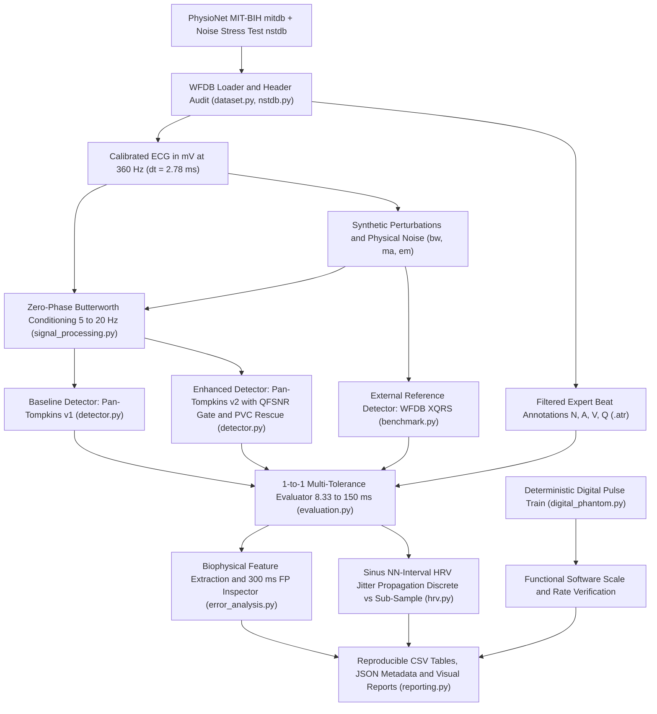

### Core Modules (`src/ecg_integrity/`)

| Module | Engineering Responsibility |
| :--- | :--- |
| `dataset.py` | Load MIT-BIH records & `.atr` annotations; verify `fs = 360 Hz`, physical units (`mV`), ADC gain (`200 counts/mV`), baseline (`1024`), finiteness, and exclude non-beat markers (`+`, `~`, `&#124;`). |
| `signal_processing.py` | Zero-phase 4th-order Butterworth SOS bandpass (`5–20 Hz`) and reproducible synthetic perturbations (`0.25 Hz` baseline wander, `60 Hz` mains hum, seeded AWGN at `20, 10, 5 dB`). |
| `nstdb.py` | Load physical ambulatory noise (`bw`, `ma`, `em`) from PhysioNet's **MIT-BIH Noise Stress Test Database** and mix at controlled SNRs (`24` down to `-6 dB`). |
| `detector.py` | Frozen baseline `detect_qrs_pan_tompkins` (`v1`) **and** enhanced `detect_qrs_pan_tompkins_v2` (`v2`: `5–20 Hz` apex relocation, parabolic sub-sample vertex interpolation, same-band `QFSNR` artifact gate, compensatory-pause-aware `2.5–15 Hz` PVC rescue, and optional dual-lead fusion). |
| `evaluation.py` | Strict 1-to-1 beat matching (supporting both integer sample indices and continuous sub-sample peaks), **6-window tolerance sweeps** (`±8.33` to `±150 ms`), and micro-aggregated count pooling. |
| `error_analysis.py` | Beat-symbol stratification (`N, A, V, Q`), biophysical feature extraction (`A_QRS`, `W_QRS`, `max|dV/dt|`, `E_QRS / I1`), and `±300 ms` multi-stage False Positive waveform inspection. |
| `benchmark.py` | Controlled 2-way (`v0.2.0`) and **3-way (`v0.3.0`)** benchmarks comparing `Pan–Tompkins v1`, `Pan–Tompkins v2`, and `wfdb.processing.xqrs_detect` under identical inputs and tolerances. |
| `hrv.py` | Quantifies how QRS timing jitter (`RR'_i = RR_i + e_{i+1} - e_i`) biases downstream `RMSSD` and `SDNN` across verified consecutive normal-to-normal (`N–N`) sinus intervals. |
| `digital_phantom.py` | Deterministic `1.0 mV` / `60 bpm` digital pulse train for **functional and mathematical software verification** (distinct from physical hardware calibration). |
| `reporting.py` & `cli.py` | Publication-grade figure generation and CLI subcommands (`run`, `nstdb`, `diagnose`, `benchmark`, `compare-v2`). |

---

## Scope, Safety & Methodological Rigor

- **Exploratory Engineering Framework (Not a Medical Device):** This repository is a research and verification workbench, **not** a clinically validated diagnostic system or medical device. The `5–20 Hz` passband is scoped strictly to QRS complex detection and intentionally attenuates P/T waves and ST-segment morphology.
- **Discrete Sampling Interval vs. Ensemble `MAE_t` & Sub-Sample Interpolation:** At `fs = 360 Hz`, single-beat integer indices have a discrete step `Δt = 2.7778 ms`. Ensemble averages below `2.78 ms` (e.g., `0.27 ms` or `1.50 ms`) reflect arithmetic means of discrete sample offsets across thousands of beats. Continuous sub-sample R-peak timestamps (`r_peaks_subsample` via 3-point parabolic vertex interpolation) are evaluated explicitly in `v0.3.0` both against integer-quantized `.atr` labels and on continuous `N–N` `RMSSD` fidelity. Signed timing error follows `e_i = t_det,i - t_ref,i` (positive = detection lags behind `.atr`).
- **Statistical Structure:** Evaluating `10,789` reference beats across `6–7` noise conditions yields paired repeated-measures evaluation opportunities, **not** independent observations. Pooled summaries sum raw `TP`, `FP`, and `FN` counts (`compute_micro_aggregated_metrics`) rather than averaging per-record percentages. Across the full 48-record MIT-BIH corpus, records come from 47 unique subjects (`201` and `202` belong to the same patient).

---

## Project Evolution: Questions Asked, Evidence Gathered & Complete Visual Progression (`v0.1.0` → `v0.2.0` → `v0.3.0`)

Rather than overwriting earlier experiments, `ECG-Integrity-Lab` documents the complete scientific progression across three frozen milestones, showing how each engineering question exposed specific limitations that motivated the next stage.

---

### Stage 1 (`v0.1.0`) — Baseline Conditioning, Digital Verification & Perturbation Test Bench

#### Engineering Questions Investigated in `v0.1.0`
1. **Q1.1 (Software Verification & Data Integrity):** *Can we verify unit scaling (`mV`), sampling frequency (`360 Hz`), ADC metadata, and beat-annotation filtering automatically before running any detector?*
   - **Finding:** `digital_phantom.py` confirmed `0.0%` nominal amplitude/rate error (`1.0 mV`, `60.0 bpm`) and exact `+5.0%` error sensitivity under a `1.05x` gain perturbation. Header and `.atr` audits automatically excluded `119` non-beat quality/artifact markers (`~`, `&#124;`) in `Record 105` and `71` rhythm markers (`+`) in `Record 106`.
2. **Q1.2 (Out-of-Band vs. In-Band Noise):** *How does a zero-phase `5–20 Hz` Butterworth + classical Pan–Tompkins (`v1`) detector perform on clean sinus rhythm (`Record 100`, 5 min) and across a 5-record, 30-minute purposive pilot (`100, 101, 103, 105, 106` — `10,789` beats) under synthetic `0.25 Hz` wander, `60 Hz` mains interference, and `20, 10, 5 dB` AWGN?*
   - **Finding:** Out-of-band `0.25 Hz` wander and `60 Hz` mains interference caused **zero added false positives** across all `10,789` beats. Pooled baseline reached `Se = 99.89%`, `PPV = 99.66%`, `F1 = 99.77%` (`10,777 TP`, `37 FP`, `12 FN`). However, `33/37` baseline FPs were concentrated in `Record 105`, and on `Record 100` `MAE_t` increased continuously under AWGN (`1.17 → 1.70 ms` in 5 min; `1.50 → 1.96 ms` in 30 min) even while `F1` stayed at `100.00%`.

| Record (30 min) | Clinical / Signal Profile | Ref Beats | `v0.1.0` Baseline TP | `v0.1.0` Baseline FP | `v0.1.0` Baseline FN | Se (%) | PPV (%) | F1 (%) | Baseline `MAE_t` (ms) | `5 dB` AWGN `MAE_t` (ms) |
| :---: | :--- | :---: | :---: | :---: | :---: | :---: | :---: | :---: | :---: | :---: |
| **100** | Clean normal sinus + rare APCs | 2,265 | 2,265 | 0 | 0 | 100.00 | 100.00 | 100.00 | 1.50 | 1.96 (+30.7%) |
| **101** | Sinus rhythm + mild baseline drift | 1,860 | 1,859 | 4 | 1 | 99.95 | 99.79 | 99.87 | 1.86 | 2.14 (+14.8%) |
| **103** | Clean normal sinus rhythm | 2,078 | 2,077 | 0 | 1 | 99.95 | 100.00 | 99.98 | 1.92 | 2.35 (+22.3%) |
| **105** | Severe tape/electrode motion bursts | 2,565 | 2,557 | **33** | **8** | 99.69 | 98.73 | 99.20 | 1.23 | 3.56 (+190.2%) |
| **106** | Frequent multiform PVCs (25.6% `V`) | 2,021 | 2,019 | 0 | **2** | 99.90 | 100.00 | 99.95 | 2.36 | 4.27 (+81.2%) |
| **Pooled** | **Micro-aggregated counts (`v0.1.0`)** | **10,789** | **10,777** | **37** | **12** | **99.89** | **99.66** | **99.77** | — | — |

#### Stage 1 (`v0.1.0`) Complete Visual Deliverables

**Figure 1.1 — Signal Conditioning & QRS Energy Enhancement (`Record 100`, `5–20 Hz` Butterworth + Moving-Window Integration):**


**Figure 1.2 — Controlled Perturbation Suite Across All 6 Synthetic Scenarios (`Record 100`):**


**Figure 1.3 — `v0.1.0` Classification Stability (`100%` F1) vs. Monotonic Rise in R-Peak Timing Error (`Record 100`, 5 min):**


**Figure 1.4 — Beat-by-Beat R-Peak Localization Error Distribution Across Perturbations (`Record 100`):**


**Figure 1.5 — Multi-Record 30-Minute Pilot Comparison (`Records 100, 101, 103, 105, 106` — `10,789` Reference Beats):**


---

### Stage 2 (`v0.2.0`) — Critical Scientific Characterization: *"Beyond F1-Score"*

Stage 1 showed high aggregate F1 (`99.77%`), but raised four fundamental scientific questions before any honest claim of detector robustness could be made. In `v0.2.0`, we froze `Pan–Tompkins v1` and built dedicated diagnostic modules to answer each question quantitatively:

#### Engineering Questions Investigated in `v0.2.0`
1. **Q2.1 (HRV Jitter Propagation):** *When F1 remains `100.00%` on `Record 100`, does the `1.50 → 1.96 ms` timing jitter actually corrupt downstream Heart Rate Variability (`RMSSD`)?*
   - **Answer:** Yes. Across `2,196` consecutive normal-to-normal (`N–N`) sinus intervals, `5 dB` AWGN inflated `RMSSD` from `27.80 ms` (clean `.atr` reference) to **`28.51 ms` (`+2.54%`)**, proving that count-based F1 conceals beat-to-beat jitter relevant to HRV metrology.
2. **Q2.2 (Matching-Window Sensitivity):** *How much does `Record 106`'s `99.95%` F1 depend on the permissive `±150 ms` matching tolerance?*
   - **Answer:** Tightening the matching window from `±150 ms` (`±54` samples) to `±8.33 ms` (`±3` samples) caused `Record 106` baseline F1 to drop from **`99.95%` (`0 FP / 2 FN`) to `95.79%` (`84 FP / 86 FN`)** — and to **`93.96%` (`121 FP / 123 FN`) at `5 dB`** — because broad multiform PVCs shift the detected extremum `25–50 ms` away from the clinician's fiducial mark.
3. **Q2.3 (Synthetic vs. Real Ambulatory Noise — `NSTDB`):** *Does immunity to synthetic `0.25 Hz` / `60 Hz` sinusoids generalize to real physical ambulatory noise (`nstdb`: `bw`, `ma`, `em` from `24` down to `-6 dB`)?*
   - **Answer:** No. While physical `nstdb/bw` caused `0 FP` down to `-6 dB`, physical muscle artifact (`nstdb/ma`) and electrode motion (`nstdb/em`) at `-6 dB` triggered **`127 FP` (`PPV = 94.68%`)** and **`171 FP` (`PPV = 92.97%`, `σ_t = 6.38 ms`)** because mechanical skin–electrode transients inject sharp energy directly inside `5–20 Hz`.
4. **Q2.4 (Biophysical Failure Mechanisms & External `WFDB XQRS` Benchmark):** *Why exactly do the `33` FPs in `Record 105` and the `6` missed PVCs in `Record 106` (`5 dB`) happen, and how does `PT v1` compare against `WFDB XQRS`?*
   - **Answer:** `±300 ms` waveform inspection proved that `Record 105` FPs coincide directly with PhysioNet `&#124;`/`~` artifact bursts (`raw_ptp_mv` up to `5.77 mV`, surging to `27.7x THRESHOLD_I1`), whereas all `6` missed PVCs in `Record 106` (`5 dB`) exhibited **`3.2x` lower filtered slope (`18.6` vs. `58.8 mV/s`)** and `E_QRS / I1 < 0.60`. Benchmarking against `WFDB XQRS` revealed an acute trade-off: `XQRS` achieved `3x` tighter sinus timing (`0.50 ms` vs. `1.50 ms` on `100`) and fewer motion FPs on `105` (`34` vs. `43` under `em +6 dB`), **but missed `88` multiform PVCs on `Record 106` (`Se = 95.65%` vs. `99.90%` for `PT v1`)**.

#### Stage 2 (`v0.2.0`) Complete Diagnostic & Benchmark Visuals

**Figure 2.1 — Sensitivity to Temporal Matching Window (`Record 106`, `±8.33 ms` to `±150 ms`):**
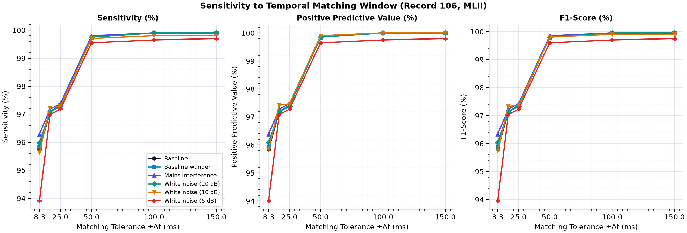

**Figure 2.2 — Real Physiological Noise Stress Test (`NSTDB`: `bw`, `ma`, `em` from `24` down to `-6 dB` on `Record 100`):**
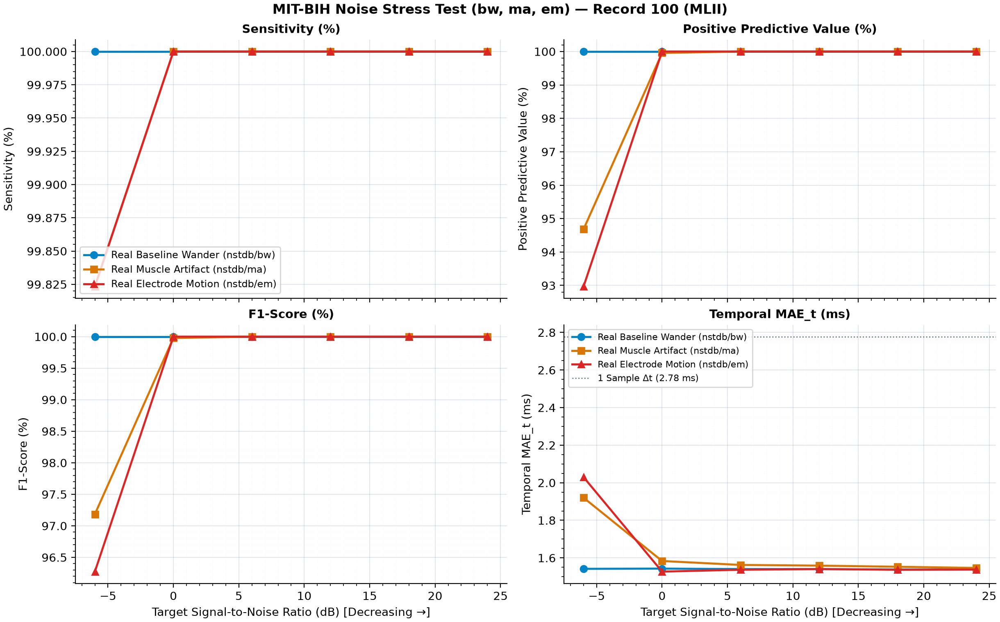

**Figure 2.3 — Multi-Stage `±300 ms` False Positive Waveform Gallery (`Record 105` Baseline — Co-Localization with `&#124;` and `~` Artifacts):**
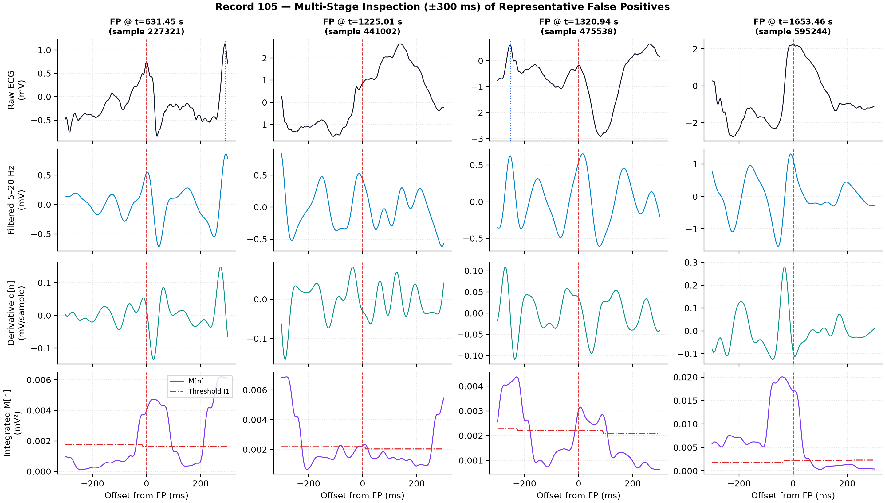

**Figure 2.4 — Biophysical Feature Comparison of Detected (`TP`) vs. Missed (`FN`) Beats (`Record 105` Baseline):**
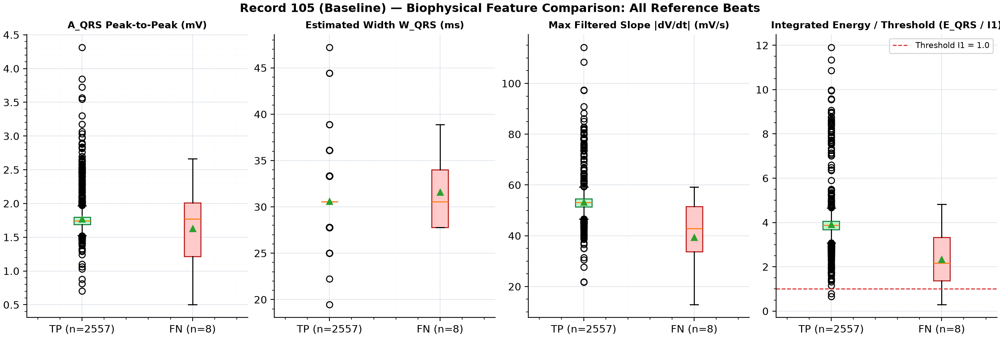

**Figure 2.5 — Biophysical Proof of Low-Slope PVC Attenuation (`Record 106` at `5 dB` AWGN: `512 TP` vs. `6 FN` PVCs):**
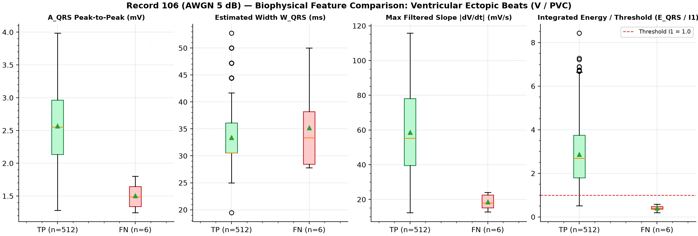

**Figure 2.6 — `v0.2.0` Two-Way Benchmark (`PT v1` vs. `WFDB XQRS`) on `Record 100` (Revealing the `1.50 ms` vs. `0.50 ms` Timing Gap):**
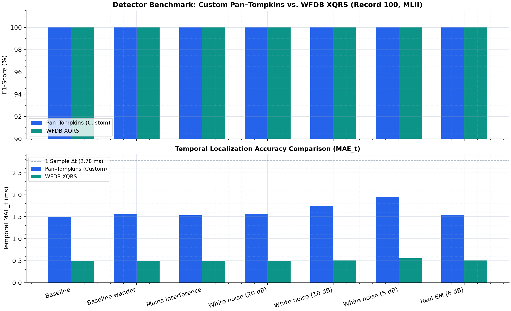

**Figure 2.7 — `v0.2.0` Two-Way Benchmark (`PT v1` vs. `WFDB XQRS`) on `Record 105` (Motion Artifact Vulnerability):**
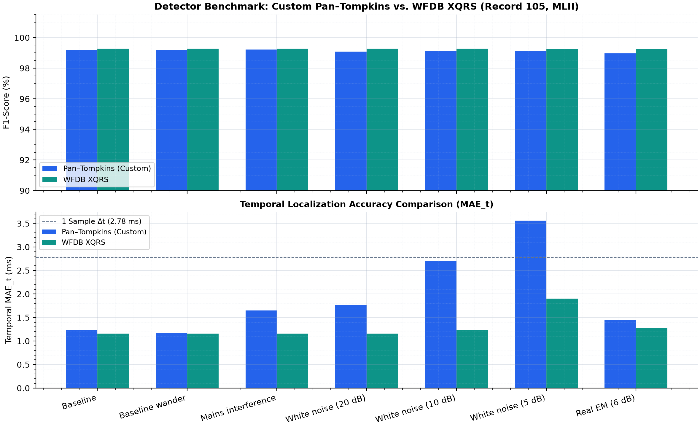

**Figure 2.8 — `v0.2.0` Two-Way Benchmark (`PT v1` vs. `WFDB XQRS`) on `Record 106` (`XQRS` Misses `88` Multiform PVCs):**
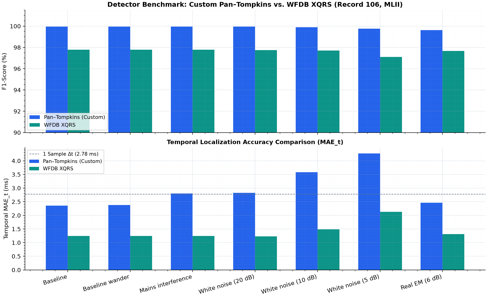

---

### Stage 3 (`v0.3.0`) — Evidence-Driven Algorithmic Upgrade (`Pan–Tompkins v2`) & Three-Way Benchmark

With `Pan–Tompkins v1` preserved intact as a frozen scientific baseline, `v0.3.0` designed **`detect_qrs_pan_tompkins_v2`** to attack the **exact three root causes** uncovered in `v0.2.0` without introducing regressions:

#### Engineering Questions & Algorithmic Solutions in `v0.3.0`
1. **Q3.1 (Target 1 — Sub-Sample Timing & HRV Metrology):** *Why did `PT v1` exhibit `1.50 ms` `MAE_t` while `XQRS` achieved `0.50 ms`, and can we eliminate downstream `RMSSD` inflation?*
   - **Root Cause & Fix:** `PT v1` ended with a `±15 ms` snap onto the **unfiltered raw waveform**, allowing broadband (`>20 Hz`) noise to perturb `argmax` and pull asymmetric R-waves `±1` sample away from MIT-BIH's band-limited `.atr` fiducial center. `Pan–Tompkins v2` relocates peaks directly on the zero-phase `5–20 Hz` conditioned apex and computes 3-point **parabolic sub-sample vertex coordinates (`r_peaks_subsample`)**.
   - **Empirical Result:** Discrete `MAE_t` dropped dramatically across **every pilot record** (`100`: `1.50 → 0.27 ms` [**beating `XQRS`'s `0.50 ms`**], `101`: `1.86 → 0.62 ms`, `103`: `1.92 → 0.19 ms`, `105`: `1.23 → 0.43 ms`, `106`: `2.36 → 1.40 ms`). On `Record 106` at strict `±8.33 ms` (`±3` samples) tolerance, baseline F1 jumped from `95.79%` (`84 FP / 86 FN`) to **`97.40%` (`52 FP / 53 FN`)**. On `Record 100` (`2,196` `N–N` pairs at `5 dB` AWGN), `RMSSD` error collapsed from **`+2.54%` (`PT v1`)** down to **`+0.22%` (`PT v2` discrete)** and **`-0.075%` (`PT v2` parabolic sub-sample: `27.78 ms` vs. `27.80 ms` reference)**! *(Notably, against integer-quantized `.atr` indices, parabolic interpolation shows `0.74 ms` apparent `MAE_t` simply because `.atr` labels are rounded to `2.78 ms` integer samples, while continuous `RMSSD` proves its superior physical inter-beat precision).*
2. **Q3.2 (Target 2 — Same-Band `QFSNR` Motion Artifact Gate):** *Can we reject non-physiological motion transients (`Record 105`, `nstdb/ma`, `nstdb/em`) without rejecting wide `130 ms` PVCs?*
   - **Root Cause & Fix:** Naive crest-factor windows (`±250 ms`) penalize wide PVCs because the PVC's own QRS energy inflates the denominator. `PT v2` computes a **same-band QRS-to-Flank Signal-to-Noise Ratio (`QFSNR`)** dividing peak amplitude in `±60 ms` by the flank RMS in `[-240..-85] U [+85..+240] ms` (excluding the `±85 ms` QRS core), suppressing abrupt short-RR (`<0.52 * median_RR`) bursts surrounded by sustained in-band clutter and `200–360 ms` post-QRS motion doublets.
   - **Empirical Result:** On `Record 105`, FPs dropped **`33 → 20` (`-39.4%`) at baseline**, **`34 → 19` (`-44.1%`) at `5 dB` AWGN**, and **`43 → 25` (`-41.9%`) under Real `NSTDB em` at `+6 dB`** — outperforming **both** `PT v1` (`43 FP`) and `WFDB XQRS` (`34 FP`)! On `Record 100` under extreme `-6 dB` physical muscle noise (`nstdb/ma`), FPs dropped **`127 → 72` (`-43.3%`, `F1 = 98.35%`)**, beating `XQRS` (`158 FP`, `F1 = 96.21%`).
3. **Q3.3 (Target 3 — Compensatory-Pause-Aware `2.5–15 Hz` Ectopic Rescue):** *Why did classical `1.66 * mean_RR` searchback miss low-slope PVCs in `Record 106` ventricular bigeminy (`N - V - pause`)?*
   - **Root Cause & Fix:** In bigeminy, prior compensatory pauses inflate `mean_RR`, preventing genuine `2-RR` missed-PVC gaps (`1.63–1.87 s`) from crossing `1.66 * mean_RR`. `PT v2` estimates clean `sinus_RR` (`0.75–1.35 * median_RR`), distinguishes true post-PVC compensatory pauses (`prev_RR < 0.72 * sinus_RR`) from genuine `2-RR` missed-beat gaps (`> 1.56 * sinus_RR`), and searches those gaps using a lower-frequency **`2.5–15 Hz` ectopic amplitude envelope** gated by `QFSNR`.
   - **Empirical Result:** On `Record 106`, missed beats dropped to **`1 FN` at baseline (`Se = 99.95%`, `F1 = 99.98%` vs. `88 FN` in `XQRS`)** and **`3 FN` (`2 FP`) at `5 dB` AWGN (`F1 = 99.88%` vs. `99.75%` for `PT v1` and `97.10%` [`22 FP / 93 FN`] for `XQRS`)**!

#### Three-Way Summary Across All 5 Full-Duration Pilot Records (`10,789` Reference Beats)

| Detector | Baseline TP / FP / FN | Baseline Se / PPV / F1 (%) | AWGN `5 dB` TP / FP / FN | AWGN `5 dB` F1 (%) | Real `EM +6 dB` TP / FP / FN | Real `EM +6 dB` F1 (%) | Rec `100` Base `MAE_t` | Rec `100` `5 dB` `RMSSD` Bias |
| :--- | :---: | :---: | :---: | :---: | :---: | :---: | :---: | :---: |
| **`Pan–Tompkins v1` (`v0.2.0`)** | 10,777 / 37 / 12 | 99.89 / 99.66 / 99.77 | 10,769 / 42 / 20 | 99.71 | 10,771 / 56 / 18 | 99.66 | 1.50 ms | +2.54% |
| **`Pan–Tompkins v2` (`v0.3.0`)** | **10,777 / 24 / 12** | **99.89 / 99.78 / 99.83** | **10,774 / 25 / 15** | **99.81** | **10,769 / 38 / 20** | **99.73** | **0.27 ms** | **+0.22% (-0.08% parab.)** |
| **`WFDB XQRS` (External Ref)** | 10,694 / 37 / 95 | 99.12 / 99.66 / 99.39 | 10,687 / 58 / 102 | 99.26 | 10,694 / 42 / 95 | 99.36 | 0.50 ms | +0.17% |

#### Stage 3 (`v0.3.0`) Complete Three-Way Comparison Visuals

**Figure 3.1 — Executive 4-Panel Three-Way Benchmark (`Pan–Tompkins v1` vs. `Pan–Tompkins v2` vs. `WFDB XQRS` Across Targets 1, 2, 3 & Pooled Errors):**
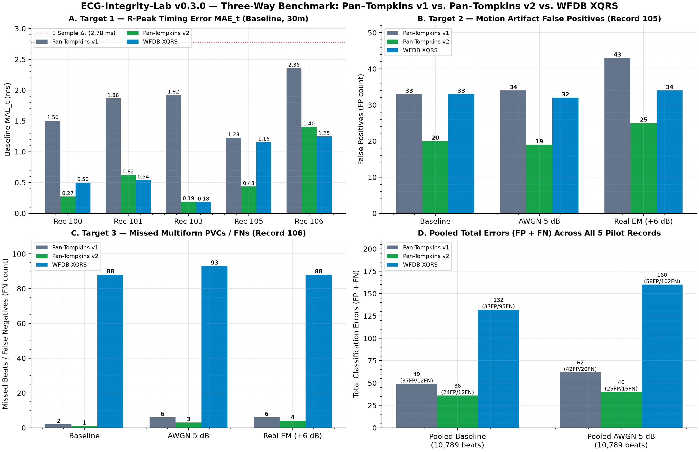

**Figure 3.2 — Quantized `.atr` Timing Alignment vs. Continuous Parabolic Sub-Sample `RMSSD` Metrology (`Record 100`, `n = 2,196` Sinus `N–N` Pairs):**
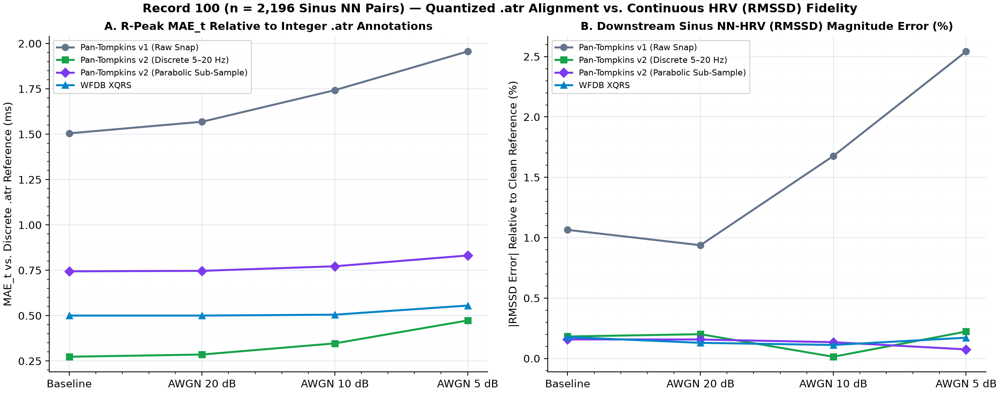

**Figure 3.3 — Three-Way Physical `NSTDB` Stress Test (`nstdb/ma` & `nstdb/em`, `24 dB` down to `-6 dB` on `Record 100`):**
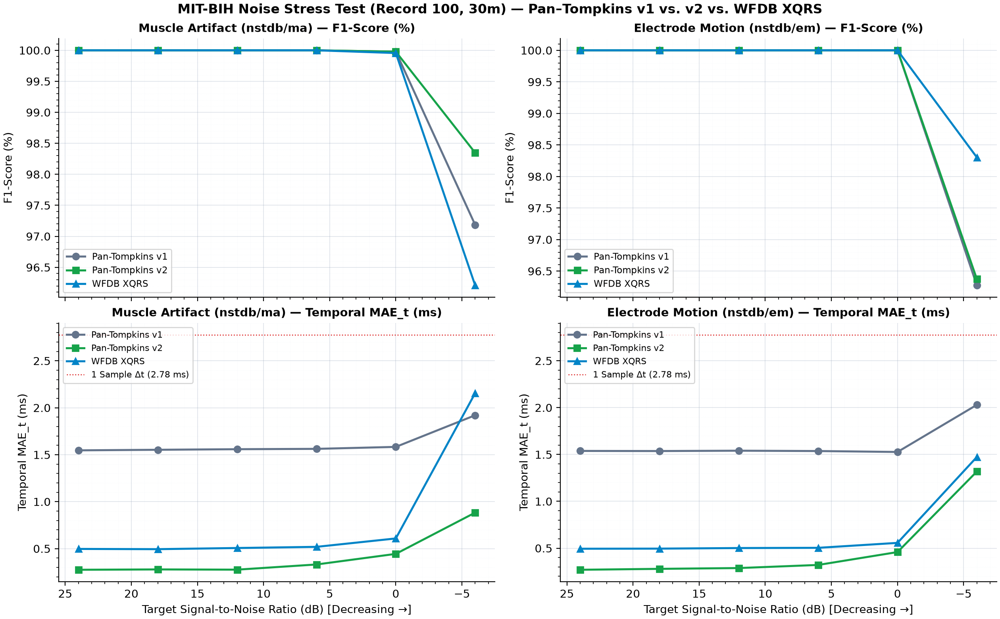

**Figure 3.4 — Three-Way Detector Benchmark on `Record 100` (Clean Sinus Rhythm — `PT v2` Achieves `0.27 ms` `MAE_t`):**
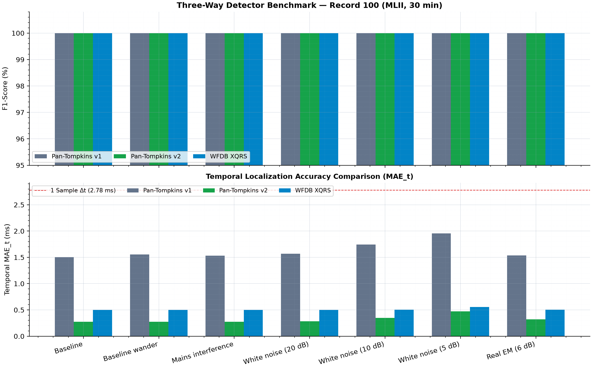

**Figure 3.5 — Three-Way Detector Benchmark on `Record 105` (Severe Motion Artifact — `PT v2` `QFSNR` Gate Leads F1 & `MAE_t`):**
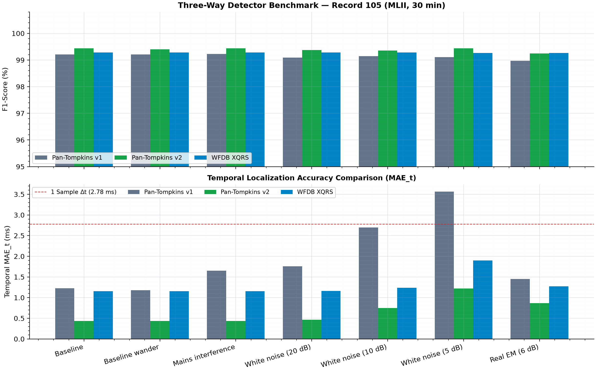

**Figure 3.6 — Three-Way Detector Benchmark on `Record 106` (Multiform Ventricular Bigeminy — `PT v2` Preserves PVC Sensitivity & Cuts Jitter):**
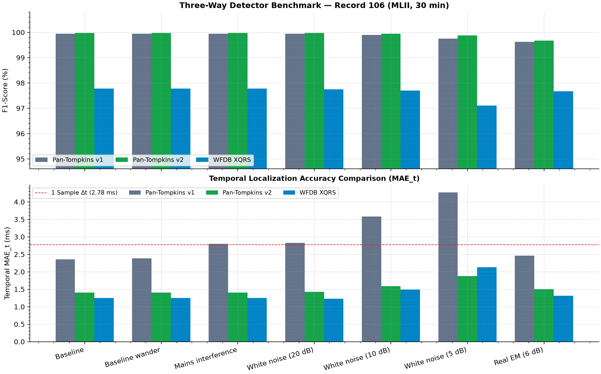

---

## Install & Reproduce Everything (Windows PowerShell)

```powershell
py -3.12 -m venv .venv
.\.venv\Scripts\Activate.ps1
python -m pip install --upgrade pip
pip install -r requirements.txt
pip install -e .
pytest -v
```

### Reproducible CLI Commands (`v0.1.0` → `v0.3.0`)

```powershell
# 0. Functional & mathematical verification via digital reference pulse train
python examples/run_digital_phantom.py

# 1. Stage 1 (v0.1.0) & Stage 2 tolerance/HRV runs
python -m ecg_integrity.cli run --record 100 --channel 0 --seconds 300
python -m ecg_integrity.cli run --record 100 --channel 0 --seconds 1800 --output results/pilot
python -m ecg_integrity.cli run --record 101 --channel 0 --seconds 1800 --output results/pilot
python -m ecg_integrity.cli run --record 103 --channel 0 --seconds 1800 --output results/pilot
python -m ecg_integrity.cli run --record 105 --channel 0 --seconds 1800 --output results/pilot
python -m ecg_integrity.cli run --record 106 --channel 0 --seconds 1800 --output results/pilot
python examples/plot_pilot_summary.py --csv results/pilot/pilot_metrics.csv

# 2. Stage 2 (v0.2.0) physical NSTDB stress test, FP/PVC diagnostics & 2-way XQRS benchmark
python -m ecg_integrity.cli nstdb --record 100 --channel 0 --seconds 1800
python -m ecg_integrity.cli diagnose --record 105 --channel 0 --seconds 1800
python -m ecg_integrity.cli diagnose --record 106 --channel 0 --seconds 1800 --snr-db 5
python -m ecg_integrity.cli benchmark --record 100 --channel 0 --seconds 1800
python -m ecg_integrity.cli benchmark --record 105 --channel 0 --seconds 1800
python -m ecg_integrity.cli benchmark --record 106 --channel 0 --seconds 1800

# 3. Stage 3 (v0.3.0) full 3-way comparison suite (Pan-Tompkins v1 vs. v2 vs. WFDB XQRS)
python -m ecg_integrity.cli compare-v2 --seconds 1800
```

---

## Engineering & QA Documentation

- [`docs/EXPERIMENTAL_PROTOCOL.md`](docs/EXPERIMENTAL_PROTOCOL.md) — Pre-specified experimental design across Stages 1–3, tolerances, `NSTDB` SNR scaling, `Pan–Tompkins v2` architecture, and statistical structure.
- [`docs/LIMITATIONS_AND_QA_REPORT.md`](docs/LIMITATIONS_AND_QA_REPORT.md) — Complete quantitative QA tables (`v0.1.0` → `v0.3.0`), error diagnostics, `RMSSD` sub-sample metrology, and methodological limitations.
- [`docs/TECHNICAL_PUBLICATION_DRAFT.md`](docs/TECHNICAL_PUBLICATION_DRAFT.md) — Manuscript draft: *"Beyond F1-Score: Evaluating and Improving Temporal Accuracy, Artifact Rejection, and Ectopic Sensitivity in QRS Detection"*.
- [`docs/REFERENCES.md`](docs/REFERENCES.md) — Full citations for MIT-BIH (`mitdb`), Noise Stress Test (`nstdb`), Pan–Tompkins, WFDB/`XQRS`, SciPy, and standards context (ANSI/AAMI EC57, IEC 60601-2-47).
