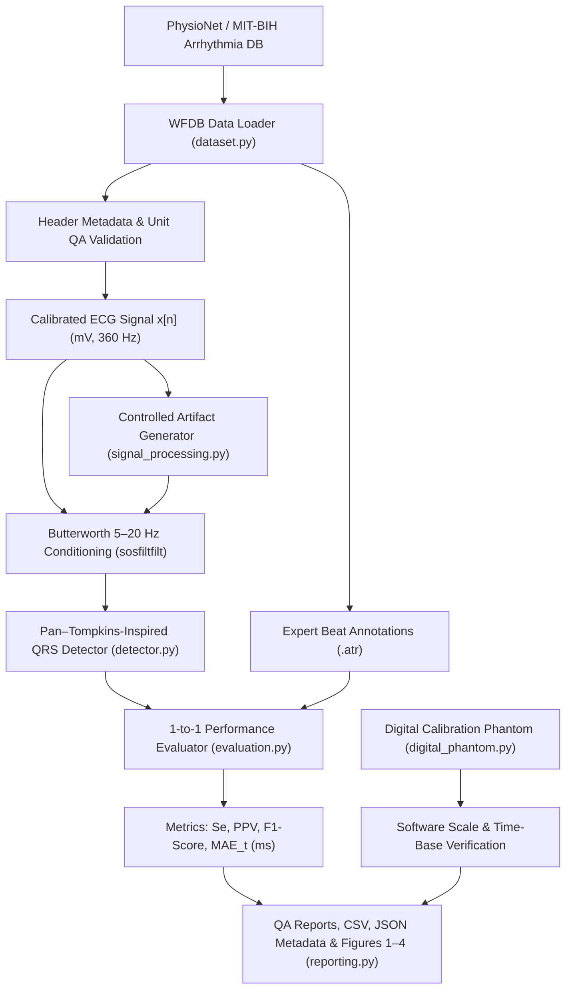
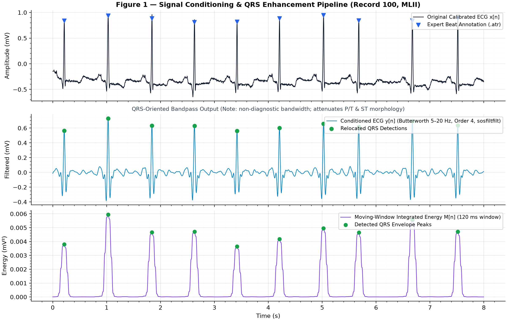
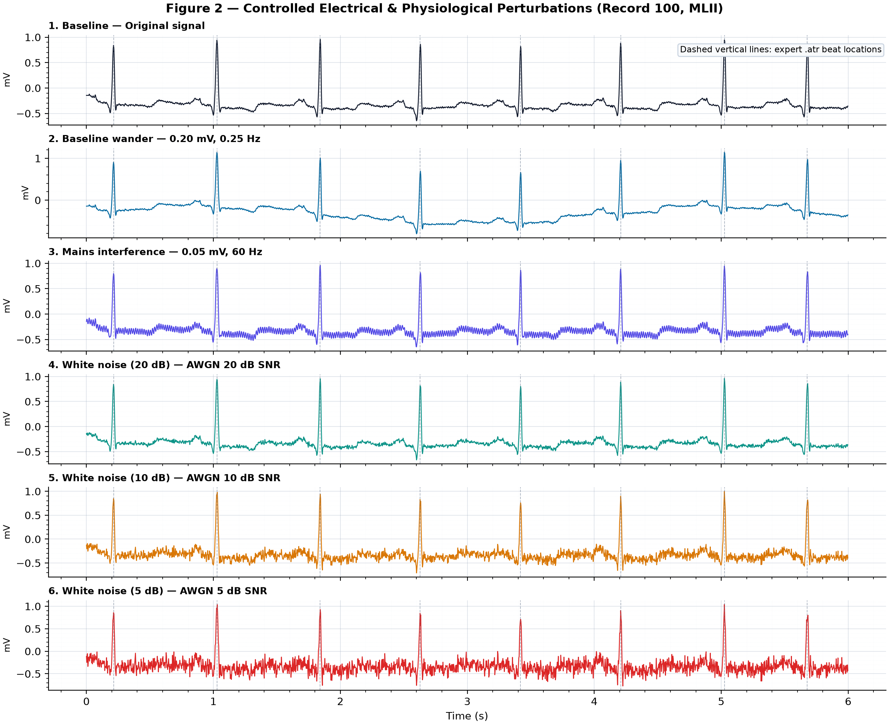
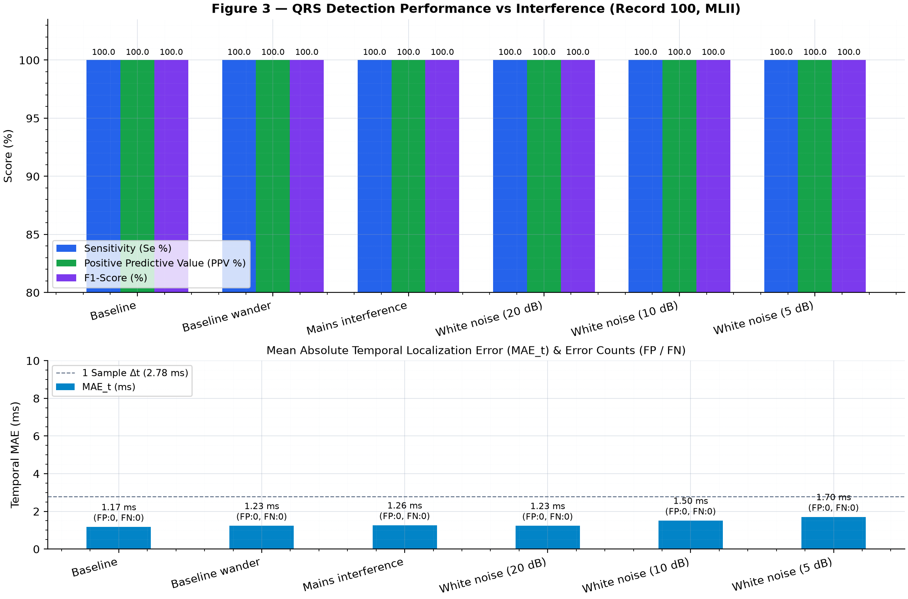
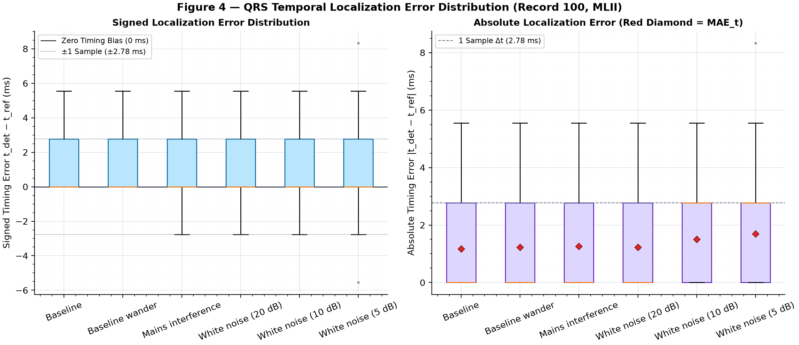
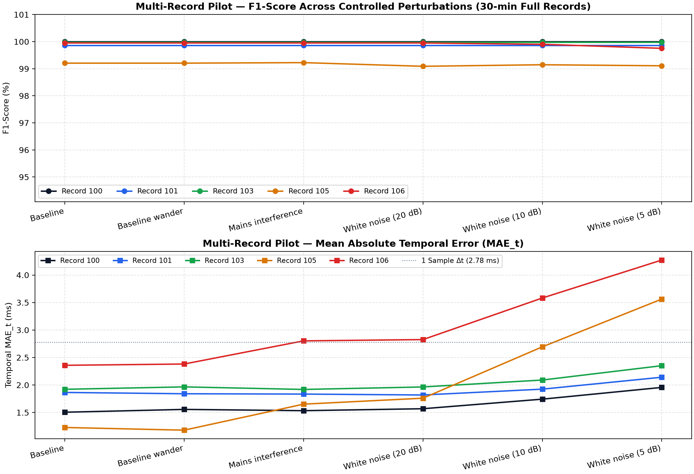

# ECG-Integrity-Lab

**Open ECG Signal Conditioning & QRS Detector Verification Framework**  
*From physiological biosignal acquisition to quantitative quality assurance*

A computer-only biomedical engineering framework designed to demonstrate physiological signal processing, instrumentation & ADC calibration concepts, metrological software verification, quantitative algorithm evaluation, Python modularity, and reproducible QA/QC.

---

## System Architecture



### Core Modules (`src/ecg_integrity/`)

| Module | Responsibility |
| :--- | :--- |
| `dataset.py` | Retrieve MIT-BIH records & `.atr` beat annotations via WFDB; verify $f_s$, physical units (`mV`), ADC gain/baseline, finiteness, and physiological bounds. |
| `signal_processing.py` | Zero-phase 4th-order Butterworth bandpass ($5\text{–}20\text{ Hz}$ via `sosfiltfilt`) and controlled perturbations (baseline wander, $60\text{ Hz}$ mains, reproducible AWGN). |
| `detector.py` | Educational Pan–Tompkins-inspired QRS detector (bandpass, centered derivative, squaring, $120\text{ ms}$ moving-window integration, adaptive dual thresholds, $\pm 90\text{ ms}$ R-peak relocation). |
| `evaluation.py` | Strict one-to-one beat matching within $\pm 150\text{ ms}$ tolerance; computes TP, FP, FN, Sensitivity, PPV, F1-score, and temporal localization error ($\text{MAE}_t$). |
| `digital_phantom.py` | Deterministic $1.0\text{ mV}$ / $60\text{ bpm}$ digital pulse train generator & evaluator for software scale and rate verification. |
| `reporting.py` | Generates publication-ready Figures 1–4, per-condition diagnostic waveforms, `metrics.csv`, and `run_metadata.json`. |

---

## What it does

- Loads ECG signals and expert-reviewed beat annotations from PhysioNet's MIT-BIH Arrhythmia Database using WFDB.
- Checks physical signal units (`mV`), sampling frequency ($360\text{ Hz}$), ADC gain, digital baseline, and finite/range integrity from the source header before filtering.
- Applies a detector-oriented $5\text{–}20\text{ Hz}$ zero-phase Butterworth bandpass filter using second-order sections (`sosfiltfilt`).
- Injects reproducible respiratory baseline wander ($0.20\text{ mV}$, $0.25\text{ Hz}$), $60\text{ Hz}$ power-line interference ($0.05\text{ mV}$), and Gaussian white noise at $20\text{ dB}$, $10\text{ dB}$, and $5\text{ dB}$ SNR.
- Runs an educational Pan–Tompkins-inspired QRS detector with adaptive signal/noise peak tracking and searchback.
- Compares detected beats to expert reference annotations using strict one-to-one matching ($\pm 150\text{ ms}$).
- Reports TP, FP, FN, Sensitivity, Positive Predictive Value (PPV), F1-score, and Mean Absolute Temporal Error ($\text{MAE}_t$).
- Includes a digital $1\text{ mV}$ / $60\text{ bpm}$ calibration phantom to unit-test amplitude and time-base calculations.
- Saves CSV metrics, JSON QA traceability metadata, per-scenario diagnostic plots, and summary Figures 1–4.

---

## Scope and safety

This is an educational research and software-verification prototype. It is **not** a medical device, diagnostic system, clinical decision-support system, or a substitute for a clinician. Do not use it to make patient-care decisions. The $5\text{–}20\text{ Hz}$ filter is intended only to demonstrate QRS detection; it does not preserve all diagnostic ECG features, including P/T waves and ST-segment morphology.

---

## Requirements

- Python 3.10 or newer (Python 3.11 / 3.12 recommended)
- Internet connection for first-time PhysioNet data retrieval (automatically cached under `data/raw/mitdb/`)
- No GPU, sensor, ECG simulator, oscilloscope, or other lab hardware required

---

## Install (Windows PowerShell)

```powershell
py -3.12 -m venv .venv
.\.venv\Scripts\Activate.ps1
python -m pip install --upgrade pip
pip install -r requirements.txt
pip install -e .
```

*(If Python 3.11 is installed on your machine, you may equivalently use `py -3.11 -m venv .venv`.)*  
If PowerShell blocks script activation, run `Set-ExecutionPolicy -Scope Process -ExecutionPolicy Bypass` and re-activate, or call `.\.venv\Scripts\python.exe` directly.

---

## Run tests

```powershell
pytest -q
```

---

## Software calibration phantom

Run the digital test vector ($1.0\text{ mV}$, $60\text{ bpm}$, $360\text{ Hz}$, $10\text{ s}$, plus $+5\%$ gain perturbation check):

```powershell
python examples/run_digital_phantom.py
```

The package provides `generate_1mv_60bpm_phantom()` and `evaluate_digital_phantom()` for a known digital pulse train. This checks software amplitude/time calculations. It is **not** a physical ECG simulator, is not traceable to SI, and cannot calibrate an ECG device.

---

## Run the 5-minute initial verification (Record 100)

```powershell
python -m ecg_integrity.cli run --record 100 --channel 0 --seconds 300
```

Outputs are saved under `results/record_100_ch0/`:

- `metrics.csv` — Quantitative metrics across all 6 experimental conditions
- `run_metadata.json` — Full QA/metrology audit & parameter traceability
- `baseline.png`, `baseline_wander.png`, `mains_interference.png`, `white_noise_20dB.png`, `white_noise_10dB.png`, `white_noise_5dB.png`
- `fig1_conditioning.png` — Figure 1: Original vs conditioned signal & integrated QRS energy
- `fig2_perturbations.png` — Figure 2: Visual comparison of controlled interferences
- `fig3_performance.png` / `metrics_summary.png` — Figure 3: Sensitivity, PPV, F1-score & $\text{MAE}_t$
- `fig4_timing_error.png` — Figure 4: Signed & absolute QRS temporal localization error distributions

Re-generate or customize the metrics summary plot:

```powershell
python examples/plot_metrics.py
```

---

## Run the 5-record full-duration pilot (~30 min per record)

```powershell
python -m ecg_integrity.cli run --record 100 --channel 0 --seconds 1800 --output results/pilot
python -m ecg_integrity.cli run --record 101 --channel 0 --seconds 1800 --output results/pilot
python -m ecg_integrity.cli run --record 103 --channel 0 --seconds 1800 --output results/pilot
python -m ecg_integrity.cli run --record 105 --channel 0 --seconds 1800 --output results/pilot
python -m ecg_integrity.cli run --record 106 --channel 0 --seconds 1800 --output results/pilot
python examples/plot_pilot_summary.py --csv results/pilot/pilot_metrics.csv
```

---

## Verified Results & Diagnostic Figures

### 1. Software Calibration Phantom (`1.0 mV`, `60 bpm`, `360 Hz`)
- **Nominal Pulse Train:** `10` pulses detected, **`0.0%` amplitude error**, **`0.0%` rate error**.
- **Scale Sensitivity (`+5%` Gain Injection, `1.05 mV`):** **`+5.0%` measured amplitude error** ($E_A$).

### 2. Multi-Record 30-Minute Pilot Summary (`10,789` Expert Reference Beats)

| Record | Profile | Baseline F1 / $\text{MAE}_t$ | Wander ($0.25\text{ Hz}$) F1 / $\text{MAE}_t$ | Mains ($60\text{ Hz}$) F1 / $\text{MAE}_t$ | AWGN $20\text{ dB}$ F1 / $\text{MAE}_t$ | AWGN $10\text{ dB}$ F1 / $\text{MAE}_t$ | AWGN $5\text{ dB}$ F1 / $\text{MAE}_t$ |
| :---: | :--- | :---: | :---: | :---: | :---: | :---: | :---: |
| **`100`** | Clean sinus ($n=2265$) | 100.00% / 1.50 ms | 100.00% / 1.56 ms | 100.00% / 1.53 ms | 100.00% / 1.57 ms | 100.00% / 1.74 ms | 100.00% / 1.96 ms |
| **`101`** | Baseline drift ($n=1860$) | 99.87% / 1.86 ms | 99.87% / 1.84 ms | 99.87% / 1.83 ms | 99.87% / 1.82 ms | 99.87% / 1.92 ms | 99.87% / 2.14 ms |
| **`103`** | Clean sinus ($n=2078$) | 99.98% / 1.92 ms | 99.98% / 1.97 ms | 99.98% / 1.92 ms | 99.98% / 1.96 ms | 99.98% / 2.09 ms | 99.98% / 2.35 ms |
| **`105`** | High-grade motion ($n=2565$) | 99.20% / 1.23 ms | 99.20% / 1.18 ms | 99.22% / 1.65 ms | 99.09% / 1.76 ms | 99.15% / 2.69 ms | 99.11% / **3.56 ms** |
| **`106`** | Multiform PVCs ($n=2021$) | 99.95% / 2.36 ms | 99.95% / 2.38 ms | 99.95% / 2.80 ms | 99.95% / 2.83 ms | 99.90% / 3.58 ms | 99.75% / **4.27 ms** |

### Key Figures (Record `100` & Multi-Record Pilot)











---

## Engineering & QA Documentation

- [`docs/EXPERIMENTAL_PROTOCOL.md`](docs/EXPERIMENTAL_PROTOCOL.md) — Pre-specified experimental design, signal conditioning equations, and 3-tier verification protocol.
- [`docs/LIMITATIONS_AND_QA_REPORT.md`](docs/LIMITATIONS_AND_QA_REPORT.md) — Empirical results analysis, failure modes under noise/arrhythmia, and metrological limitations.
- [`docs/TECHNICAL_PUBLICATION_DRAFT.md`](docs/TECHNICAL_PUBLICATION_DRAFT.md) — Structured technical article summarizing methodology and empirical findings.
- [`docs/REFERENCES.md`](docs/REFERENCES.md) — Dataset, algorithmic, and standards citations.

---

## Dataset and citations

The MIT-BIH Arrhythmia Database is open access under the Open Data Commons Attribution License v1.0. Cite both:

- Moody GB, Mark RG. *MIT-BIH Arrhythmia Database (version 1.0.0).* PhysioNet. https://doi.org/10.13026/C2F305
- Moody GB, Mark RG. The impact of the MIT-BIH Arrhythmia Database. *IEEE Eng Med Biol Mag.* 2001;20(3):45–50. https://doi.org/10.1109/51.932724

Also cite the WFDB Python package when used: https://wfdb.io/software/python.html

---

## Standards context

ANSI/AAMI EC57:2012 (R2020) describes methods for testing and reporting performance of cardiac rhythm and ST-segment measurement algorithms. This project is **not** an implementation of the complete standard and does not claim conformity. Obtain and review the full standard before making any standards-compliance claim.

IEC 60601-2-47:2012 concerns basic safety and essential performance of ambulatory ECG systems. It is useful background for device-specific context, but this software-only exercise does not assess electrical safety or conformity of an ECG device.
